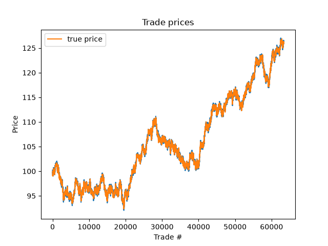

# Limit Order Book

A limit order book and matching engine written in C++, driven by a simulated market, with the results analyzed in Python. I built it to learn C++ and to understand how exchanges actually match buyers and sellers.

## Features

- **Price-time priority matching**: best price first, and at the same price, the earliest order first
- **Partial fills and walking the book**: a large order trades through several price levels until it's filled or no prices cross
- **Stale-order cancellation**: resting orders too far from the current fair value are removed
- **Integer tick prices**: prices are stored as whole cents to avoid floating-point errors
- **Simulated market**: fair value follows a random walk, and orders arrive randomly around it
- **CSV output + Python plotting** of every trade against the true price

## How to run

```bash
clang++ -std=c++17 -O2 -o orderbook orderbook.cpp && ./orderbook
python plot_trades.py
```

The simulation runs 100,000 random orders, writes every trade to `trades.csv`, and prints a summary of the final book.

## Experiment 1: The cancellation trade-off

Without cancellation, orders left behind when the price moved just sat in the book. When the price fell, new sell orders kept trading against old bids that were now above fair value, so trade prices lagged behind the true price, by about 1.5 at the end of the run. In trading this is called **adverse selection**: whoever leaves a stale order gets traded against exactly when their price has become a bad one.

To fix it, I cancel any resting order more than a set distance from the true price, and tested four cutoffs:

| Cutoff | Spread | Trades | Resting orders | Avg gap from true price |
|---|---|---|---|---|
| 0.5 | none | 3,168 | 4 | 0.196 |
| 1.0 | 0.39 | 3,912 | 28 | 0.314 |
| 1.5 | 0.31 | 4,133 | 70 | 0.467 |
| 3.0 | 0.11 | 4,248 | 249 | 0.732 |

*(5,000 orders per run, seed 42)*



**What I found:** it's a trade-off between accuracy and liquidity. A tight cutoff keeps trades close to the true price, but the book gets so thin that it sometimes has no bids at all, and about 1,000 trades never happen. A loose cutoff gives a deep book and the tightest spread, but the worst price accuracy. The 3.0 run had the *best* spread and the *worst* gap, so a tight spread doesn't mean prices are accurate. Each extra trade cost more accuracy than the last, so I settled on **1.0** as the default.

## Experiment 2: Performance

The first version stored every order in one vector and scanned the whole thing to find the best price. I rebuilt the book as two `std::map`s (bids and asks), mapping each price to a list of orders at that price, so the best price is always at one end of a sorted map.

Time to process 100,000 orders (`-O2`):

| Cutoff | Resting orders | Vector | Map | Map + smart cancel |
|---|---|---|---|---|
| 0.5 | 11 | 11.7 ms | 17.8 ms | **10.5 ms** |
| 3.0 | 545 | 60.7 ms | 48.0 ms | **18.9 ms** |
| 1000 | 6,821 | 381 ms | 151 ms | **12.6 ms** |

**What I found:**
- **Switching to a map was slower at first.** With only 11 resting orders, scanning a small vector is extremely fast, and the map's overhead (scattered memory, allocating price levels) cost more than it saved. The map only pulled ahead as the book grew.
- **The real bottleneck was cancellation.** My cancel function still checked every price level after every order. Since the map is sorted, prices too far from fair value can only be at the two ends, so the improved version only checks there. That made the engine **1.1× to 30× faster** than the original, depending on book size.
- **Every version produced identical trades.** I ran a regression test after each change (same seed, same settings, same trade count) to make sure the speedups didn't change the results.

## Next steps

- Cancel individual orders by id, instead of only by distance from fair value
- Track profit and loss for a simple market-making strategy
- Monte Carlo option pricing using the same random-walk model